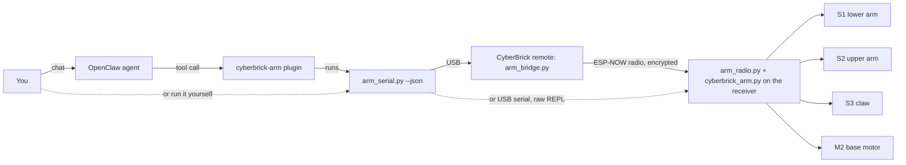

<p align="center">
  
</p>

# OpenClaw AI Robotic Arm

Control the [Robotic Arm - CyberBrick](https://makerworld.com/en/models/3379322-robotic-arm-cyberbrick)
from your PC and let an [OpenClaw](https://github.com/openclaw/openclaw) AI agent drive it
in plain language: *"turn left a bit and open the claw"*, *"pick up the block on the right
and hand it to me"*, *"wave"*.

> **The arm:** this project was built for the
> [Robotic Arm - CyberBrick](https://makerworld.com/en/models/3379322-robotic-arm-cyberbrick)
> model on MakerWorld, a 3D-printed desktop arm powered by the
> [CyberBrick](https://makerworld.com/en/cyberbrick) electronics kit. Print and assemble
> it from that page first, then use this project to control it from your PC or an AI agent.

The project has three parts:

- **Board code** (MicroPython):
  - [src/cyberbrick_arm.py](src/cyberbrick_arm.py) runs on the arm's receiver board. It
    drives the servos and the motor, keeps track of where everything is, and enforces the
    safety limits.
  - [src/arm_radio.py](src/arm_radio.py) and [src/arm_bridge.py](src/arm_bridge.py) carry
    commands over the radio, from the CyberBrick remote to the arm.
- **PC driver** ([src/arm_serial.py](src/arm_serial.py)): a command-line tool that sends
  commands to the arm over the radio (through the remote) or over USB. You can use it on
  its own, or have it print JSON for other programs.
- **OpenClaw plugin** ([openclaw-plugin/](openclaw-plugin/)): turns the driver into
  agent tools, and adds skills that teach the agent how to use the arm.

## Features

- **Arm joints:** move the lower and upper arm at any speed, one at a time or together,
  by position: 0 = home (folded) to 180 = fully extended. `arm-calibrate` records which
  servo angles those are for your arm, so the arm never drives past folded or extended,
  and the agent knows which way is up.
- **Claw:** open it fully, close it fully, or stop part way (for example half open).
- **Base:** face an angle or turn by a number of degrees. It never goes more than
  **90° left or right of centre**.
- **Position tracking without sensors:** the base and claw positions are estimated from
  timing, calibrated once, and saved between runs.
- **AI control:** 9 OpenClaw tools and 3 skills, covering basic moves, pick-and-place,
  hand-over, gestures (wave, nod, shake, scan) and troubleshooting.
- **Safe by default:**
  - The 90° base limit is checked in three places: the tool schema, the plugin and the
    board.
  - The joints have configurable limits.
  - Commands run one at a time.
- **Wireless:** after a one-time USB install, the arm takes commands over the radio
  through the CyberBrick remote, so its USB cable is never needed again. Updates and
  calibration work over the radio too.
- **Remote still works:** no stock file is replaced. `remote` hands the arm back to the
  stick remote. If radio mode ever fails to start, the arm falls back to the stock
  firmware by itself.

## How it works



The receiver board and the remote are ESP32-C3 boards running MicroPython, and the
CyberBrick kit already links them over ESP-NOW radio.

- **In radio mode**, a small boot hook starts `arm_radio.py` on the arm instead of the
  stock firmware. `arm_serial.py` sends each command to the remote over USB, and the remote
  sends it to the arm over the radio. The arm only accepts a fixed list of arm commands,
  only from its paired remote, and answers with its status when the move is done.
- **Over USB**, `arm_serial.py` interrupts the stock firmware, loads the arm library, and
  sends each command as a short MicroPython snippet.

Either way, a 10 ms timer on the board moves the servos smoothly and stops the claw and
base when they reach their targets.

## Hardware

The code is written for the
[Robotic Arm - CyberBrick](https://makerworld.com/en/models/3379322-robotic-arm-cyberbrick)
model from MakerWorld. Print and build it as described on the model page, then wire it to
the CyberBrick receiver like this:

| Port on receiver | Part      | Type                                       |
| ---------------- | --------- | ------------------------------------------ |
| S1               | Lower arm | 180° servo                                 |
| S2               | Upper arm | 180° servo                                 |
| S3               | Claw      | 360° continuous servo                      |
| M2               | Base      | DC motor                                   |

You also need:

- the **CyberBrick remote** (transmitter) with a USB cable to your PC, for radio control;
- a USB cable to the arm's **receiver** board, once, for the first install (or all the
  time, if you use USB mode);
- the arm's battery, switched on, because USB alone does not power the servos and motor.

Tested on Linux (WSL, `/dev/ttyACM0`). The driver also supports Windows (`COM5` etc.) and
macOS.

If you built a different CyberBrick arm, or wired it differently, change the port numbers
and joint limits in the `CONFIG` section of
[src/cyberbrick_arm.py](src/cyberbrick_arm.py). Then run `arm_serial.py install`.

## Quick start

### 1. Drive the arm from the command line

```bash
pip install -r requirements.txt

python arm_serial.py radio-pair       # USB in the remote: make it the radio bridge
python arm_serial.py radio-install    # USB in the arm, once: install radio mode
                                      # ...then unplug the arm's USB for good
python arm_serial.py ping             # check the radio link
python arm_serial.py arm-calibrate    # joint home and fully extended positions (once, interactive)
python arm_serial.py arm-align        # only if a joint can't extend far enough (re-seat it on its servo)
python arm_serial.py base-calibrate   # time a 90° base turn (once, interactive)

python arm_serial.py status
python arm_serial.py move 90 120       # joint positions: 0 = home .. 180 = extended
python arm_serial.py claw open
python arm_serial.py turn -45         # face 45° left
python arm_serial.py home
```

To use USB instead of the radio, run `python arm_serial.py install` with USB in the arm.
Then use the same commands.

See [src/README.md](src/README.md) for every command, the calibration steps, the radio
details, the measured RAM and flash budget, the Python API, and troubleshooting.

### 2. Let OpenClaw control it

```bash
cd openclaw-plugin
npm install
openclaw plugins install --link "/path/to/openclaw-plugin"
```

Allow the plugin's tools in `~/.openclaw/openclaw.json`:

```json5
{
  tools: {
    alsoAllow: ["cyberbrick-arm"],
  },
}
```

Then restart the gateway and start talking to it:

```bash
openclaw gateway restart
openclaw agent -m "Wave with the arm"
```

You can also call a skill directly in chat, for example `/cyberbrick-arm-routines wave`.
See [openclaw-plugin/README.md](openclaw-plugin/README.md) for the tool list and settings.

## Agent tools

| Tool                         | Does                                              |
| ---------------------------- | ------------------------------------------------- |
| `cyberbrick_arm_status`      | Report joint angles, claw opening and base angle  |
| `cyberbrick_arm_rotate_base` | Turn left or right by 1-90°, stopping at the limit |
| `cyberbrick_arm_face_angle`  | Point the base at -90..90° (0 = straight ahead)   |
| `cyberbrick_arm_move`        | Move the lower and/or upper joint                 |
| `cyberbrick_arm_open_claw`   | Open the claw                                     |
| `cyberbrick_arm_close_claw`  | Close the claw                                    |
| `cyberbrick_arm_set_claw`    | Open the claw part way                            |
| `cyberbrick_arm_home`        | Return to the home pose                           |
| `cyberbrick_arm_stop`        | Stop immediately                                  |

## Project layout

```
.
├── contrib/
│   └── cyberarm.png           header image
├── src/
│   ├── cyberbrick_arm.py      MicroPython arm library (runs on the board)
│   ├── arm_radio.py           radio mode on the arm (ESP-NOW server)
│   ├── arm_bridge.py          radio bridge on the CyberBrick remote
│   ├── arm_boot.py            boot hook for both boards
│   ├── arm_serial.py          PC driver / CLI
│   ├── tests/                 radio and protocol tests (run on the PC)
│   ├── requirements.txt       pyserial, mpy-cross
│   └── README.md              driver and library documentation
└── openclaw-plugin/
    ├── index.ts               tool definitions
    ├── openclaw.plugin.json   plugin manifest and config schema
    ├── skills/                cyberbrick-arm, -routines, -setup
    └── README.md              plugin documentation
```

## Limitations

- The base and claw have no position sensors. Their positions are estimates and can drift
  over many moves, or be wrong after the arm is moved by hand or with the remote.
  Re-centre the base with `arm_serial.py base-set 0`.
- Joint positions are a scale from folded to fully extended, not degrees. Until
  `arm-calibrate` is run they are raw servo angles (home 90), and the agent asks you
  which way a joint moves the first time it needs to know.
- Each joint's fully extended position is set with the other joint at home. Whether the
  upper arm can reach the table also depends on where the lower arm is, so leave a few
  degrees spare.
- Each command opens the serial port again (to the remote, or to the arm over USB),
  which adds about a second.
- Radio mode and the stick remote take turns. `remote` gives the arm to the sticks
  until it is switched off and on. While the remote is the radio bridge, its sticks do
  nothing.
- Pairing a different remote, or removing radio mode completely, needs the arm's USB
  cable again.

## Acknowledgements

- Arm design: [Robotic Arm - CyberBrick](https://makerworld.com/en/models/3379322-robotic-arm-cyberbrick)
  on MakerWorld.
- The serial connection code follows the approach of
  [unbug/CyberClaw](https://github.com/unbug/CyberClaw)'s CyberBrick driver.
- Built on the CyberBrick MicroPython firmware and its `bbl` servo and motor libraries.
