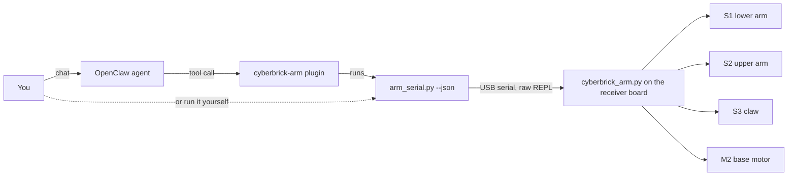

<p align="center">
  
</p>

# OpenClaw AI Robotic Arm

Control the [Robotic Arm - CyberBrick](https://makerworld.com/en/models/3379322-robotic-arm-cyberbrick)
from your PC and let an [OpenClaw](https://github.com/openclaw/openclaw) AI agent drive it
in plain language: *"turn left a bit and open the claw"*, *"pick up the block on the right
and hand it to me"*, *"wave"*.

> **The arm:** this project was built for the
> [Robotic Arm - CyberBrick](https://makerworld.com/en/models/3379322-robotic-arm-cyberbrick)
> model on MakerWorld, a 3D-printed desktop arm powered by the
> [CyberBrick](https://makerworld.com/en/cyberbrick) electronics kit. Print and assemble
> it from that page first, then use this project to control it from your PC or an AI agent.

The project has three parts:

- **Board library** ([src/cyberbrick_arm.py](src/cyberbrick_arm.py)): MicroPython running
  on the arm's receiver board. It drives the servos and the motor, keeps track of where
  everything is, and enforces the safety limits.
- **PC driver** ([src/arm_serial.py](src/arm_serial.py)): a command-line tool that talks
  to the board over USB serial. You can use it on its own, or have it print JSON for
  other programs.
- **OpenClaw plugin** ([openclaw-plugin/](openclaw-plugin/)): turns the driver into
  agent tools, and adds skills that teach the agent how to use the arm.

## Features

- **Arm joints:** move the lower and upper arm (0-180°) at any speed, one at a time or
  together.
- **Claw:** open it fully, close it fully, or stop part way (for example half open).
- **Base:** face an angle or turn by a number of degrees. It never goes more than
  **90° left or right of centre**.
- **Position tracking without sensors:** the base and claw positions are estimated from
  timing, calibrated once, and saved between runs.
- **AI control:** 9 OpenClaw tools and 3 skills, covering basic moves, pick-and-place,
  hand-over, gestures (wave, nod, shake, scan) and troubleshooting.
- **Safe by default:**
  - The 90° base limit is checked in three places: the tool schema, the plugin and the
    board.
  - The joints have configurable limits.
  - Commands run one at a time.
- **Remote still works:** installing the library does not replace the stock firmware.
  The board still boots into normal CyberBrick remote-control mode.

## How it works



The receiver board runs an ESP32-C3 with MicroPython. `arm_serial.py` interrupts the stock
firmware, loads the arm library (from flash if it is installed), and sends each command as
a short MicroPython snippet. On the board, a 10 ms timer moves the servos smoothly and
stops the claw and base when they reach their targets.

## Hardware

The code is written for the
[Robotic Arm - CyberBrick](https://makerworld.com/en/models/3379322-robotic-arm-cyberbrick)
model from MakerWorld. Print and build it as described on the model page, then wire it to
the CyberBrick receiver like this:

| Port on receiver | Part      | Type                                       |
| ---------------- | --------- | ------------------------------------------ |
| S1               | Lower arm | 180° servo                                 |
| S2               | Upper arm | 180° servo                                 |
| S3               | Claw      | 360° continuous servo                      |
| M2               | Base      | DC motor                                   |

You also need:

- a USB cable from your PC to the arm's **receiver** board;
- the arm's battery, switched on, because USB alone does not power the servos and motor.

Tested on Linux (WSL, `/dev/ttyACM0`). The driver also supports Windows (`COM5` etc.) and
macOS.

If you built a different CyberBrick arm, or wired it differently, change the port numbers
and joint limits in the `CONFIG` section of
[src/cyberbrick_arm.py](src/cyberbrick_arm.py). Then run `arm_serial.py install`.

## Quick start

### 1. Drive the arm from the command line

```bash
pip install -r requirements.txt

python arm_serial.py install          # put the library on the board (once)
python arm_serial.py base-calibrate   # time a 90° base turn (once, interactive)

python arm_serial.py status
python arm_serial.py move 110 70
python arm_serial.py claw open
python arm_serial.py turn -45         # face 45° left
python arm_serial.py home
```

See [src/README.md](src/README.md) for every command, the calibration steps, the Python
API, and troubleshooting.

### 2. Let OpenClaw control it

```bash
cd openclaw-plugin
npm install
openclaw plugins install --link "/path/to/openclaw-plugin"
```

Allow the plugin's tools in `~/.openclaw/openclaw.json`:

```json5
{
  tools: {
    alsoAllow: ["cyberbrick-arm"],
  },
}
```

Then restart the gateway and start talking to it:

```bash
openclaw gateway restart
openclaw agent -m "Wave with the arm"
```

You can also call a skill directly in chat, for example `/cyberbrick-arm-routines wave`.
See [openclaw-plugin/README.md](openclaw-plugin/README.md) for the tool list and settings.

## Agent tools

| Tool                         | Does                                              |
| ---------------------------- | ------------------------------------------------- |
| `cyberbrick_arm_status`      | Report joint angles, claw opening and base angle  |
| `cyberbrick_arm_rotate_base` | Turn left or right by 1-90°, stopping at the limit |
| `cyberbrick_arm_face_angle`  | Point the base at -90..90° (0 = straight ahead)   |
| `cyberbrick_arm_move`        | Move the lower and/or upper joint                 |
| `cyberbrick_arm_open_claw`   | Open the claw                                     |
| `cyberbrick_arm_close_claw`  | Close the claw                                    |
| `cyberbrick_arm_set_claw`    | Open the claw part way                            |
| `cyberbrick_arm_home`        | Return to the home pose                           |
| `cyberbrick_arm_stop`        | Stop immediately                                  |

## Project layout

```
.
├── contrib/
│   └── cyberarm.png           header image
├── src/
│   ├── cyberbrick_arm.py      MicroPython arm library (runs on the board)
│   ├── arm_serial.py          PC driver / CLI
│   ├── requirements.txt       pyserial, mpy-cross
│   └── README.md              driver and library documentation
└── openclaw-plugin/
    ├── index.ts               tool definitions
    ├── openclaw.plugin.json   plugin manifest and config schema
    ├── skills/                cyberbrick-arm, -routines, -setup
    └── README.md              plugin documentation
```

## Limitations

- The base and claw have no position sensors. Their positions are estimates and can drift
  over many moves, or be wrong after the arm is moved by hand or with the remote.
  Re-centre the base with `arm_serial.py base-set 0`.
- Which way a joint moves as its angle increases depends on how the servo is mounted.
  The agent asks you the first time it needs to know. You can also write the answer into
  [the arm skill](openclaw-plugin/skills/cyberbrick-arm/SKILL.md).
- Each command opens the serial port again, which adds about a second.

## Acknowledgements

- Arm design: [Robotic Arm - CyberBrick](https://makerworld.com/en/models/3379322-robotic-arm-cyberbrick)
  on MakerWorld.
- The serial connection code follows the approach of
  [unbug/CyberClaw](https://github.com/unbug/CyberClaw)'s CyberBrick driver.
- Built on the CyberBrick MicroPython firmware and its `bbl` servo and motor libraries.
