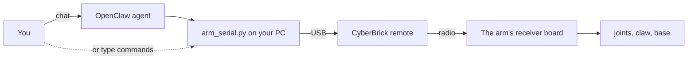

<p align="center">
  
</p>

# OpenClaw AI Robotic Arm

Turn your 3D-printed
[Robotic Arm - CyberBrick](https://makerworld.com/en/models/3379322-robotic-arm-cyberbrick)
into a robot you can talk to. Drive it from your PC's command line, or let an
[OpenClaw](https://github.com/openclaw/openclaw) AI agent move it for you in plain
language:

> *"Turn left a bit and open the claw."*
> *"Pick up the block on the right and hand it to me."*
> *"Wave!"*

**What you can do with it:**

- Move the two arm joints, open and close the claw, and turn the base to any angle up to
  90° either side, smoothly and at the speed you choose.
- Control the arm **wirelessly** through the CyberBrick remote, after plugging the arm in
  only once.
- Let an AI agent pick things up, hand them over, wave, nod and more.
- Hand the arm back to the stick remote whenever you like. Nothing in the stock firmware
  is replaced.

## Documentation

This page gets you up and running. For everything else, see:

| Read this | For |
| --------- | --- |
| **[src/README.md](src/README.md)** | Every command and option, calibration in detail, how the radio works, radio diagnostics and settings, known problems, the Python API, and troubleshooting |
| **[openclaw-plugin/README.md](openclaw-plugin/README.md)** | The AI agent tools, skills and plugin settings |

**Please review [src/README.md](src/README.md) for advanced usage** once you have the arm
moving.

## How it fits together



A small program on your PC (`arm_serial.py`) sends commands through the CyberBrick
remote, which passes them to the arm over the kit's own encrypted radio link. The arm
runs our MicroPython code, which moves the servos smoothly and keeps them within safe
limits.

## What you need

- The **[Robotic Arm - CyberBrick](https://makerworld.com/en/models/3379322-robotic-arm-cyberbrick)**,
  printed and built as described on its MakerWorld page, wired like this:

  | Receiver port | Part      |
  | ------------- | --------- |
  | S1            | Lower arm (180° servo) |
  | S2            | Upper arm (180° servo) |
  | S3            | Claw (360° servo) |
  | M2            | Base (DC motor) |

- The **CyberBrick remote** and a USB cable to your PC.
- **Python 3** on your PC. Tested on Linux (including WSL).
- The arm's **battery**, charged and switched on: USB powers the boards, not the motors.

## Quick start

All commands run from the `src/` folder.

**1. Install the PC software**

```bash
cd src
python -m venv .venv
source .venv/bin/activate
pip install -r requirements.txt
```

On Linux, your user needs to be in the `dialout` group to use the USB port. On WSL,
attach each board with `usbipd.exe attach --wsl --busid <id>`.

**2. Set up wireless control (once)**

```bash
python arm_serial.py radio-pair       # USB cable in the CyberBrick remote
python arm_serial.py radio-install    # USB cable in the arm's receiver board
```

The arm restarts with a dim blue light. Unplug its USB cable: you won't need it again.
Plug the cable back into the remote and check the link:

```bash
python arm_serial.py ping
```

**3. Calibrate (once)**

These walk you through each step and save the results on the arm:

```bash
python arm_serial.py arm-calibrate     # where each joint is folded and fully extended
python arm_serial.py base-tune         # how long a 90° base turn takes
python arm_serial.py claw-calibrate    # how long the claw takes to open and close
```

**4. Move the arm**

```bash
python arm_serial.py status
python arm_serial.py move 90 120       # joints: 0 = folded .. 180 = fully extended
python arm_serial.py claw open
python arm_serial.py turn -45          # face 45° left
python arm_serial.py gesture wave
python arm_serial.py home
```

`python arm_serial.py help` lists every command.

**5. Let an AI agent drive it (optional)**

```bash
cd openclaw-plugin
npm install
openclaw plugins install --link "/path/to/openclaw-plugin"
```

Allow its tools in `~/.openclaw/openclaw.json` with `tools: { alsoAllow: ["cyberbrick-arm"] }`,
then:

```bash
openclaw gateway restart
openclaw agent -m "Wave with the arm"
```

See [openclaw-plugin/README.md](openclaw-plugin/README.md) for the tools and settings.

## Good to know

- **The radio sometimes drops out.** Now and then the link goes quiet for a few seconds
  up to about two minutes, then recovers by itself. Commands are slow or fail during that
  time. Wait a little and try again. `python arm_serial.py debug` shows what happened.
  This is being investigated: see
  [Known problem: deaf spells](src/README.md#known-problem-deaf-spells).
- **Base and claw positions are estimates.** They have no sensors, so if you move the arm
  by hand or with the sticks, centre the base and run `python arm_serial.py base-set 0`.
- **The stick remote still works.** `python arm_serial.py remote` hands the arm back to
  the sticks until you switch the arm off and on.
- **Prefer a cable?** Skip step 2 and plug USB straight into the arm's receiver board;
  commands then go over USB.

## Project layout

```
src/               PC driver (arm_serial.py), board code and tests; see src/README.md
openclaw-plugin/   OpenClaw tools and skills; see openclaw-plugin/README.md
contrib/           images
```

## Acknowledgements

- Arm design: [Robotic Arm - CyberBrick](https://makerworld.com/en/models/3379322-robotic-arm-cyberbrick)
  on MakerWorld.
- The serial connection code follows the approach of
  [unbug/CyberClaw](https://github.com/unbug/CyberClaw)'s CyberBrick driver.
- Built on the CyberBrick MicroPython firmware and its `bbl` servo and motor libraries.

## Support me

If this project helped you get your arm moving, you can support its development:

[](https://buymeacoffee.com/bekindpleaserewind)

[buymeacoffee.com/bekindpleaserewind](https://buymeacoffee.com/bekindpleaserewind)
